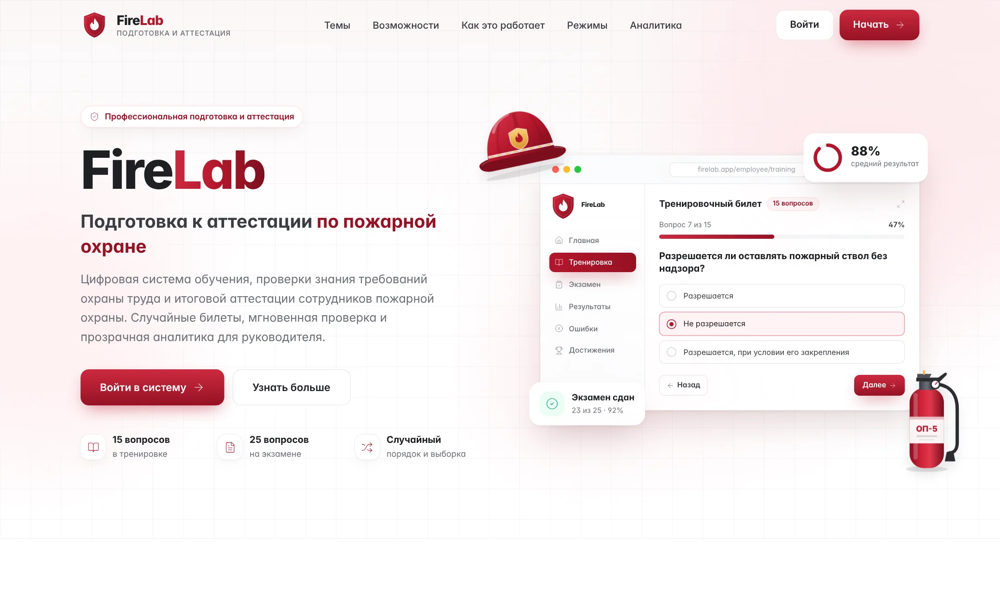
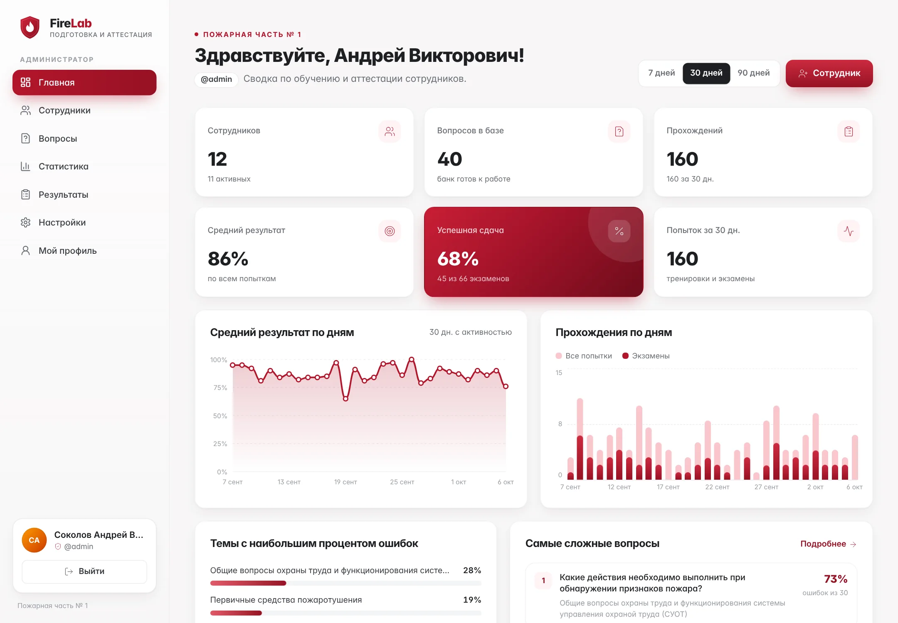
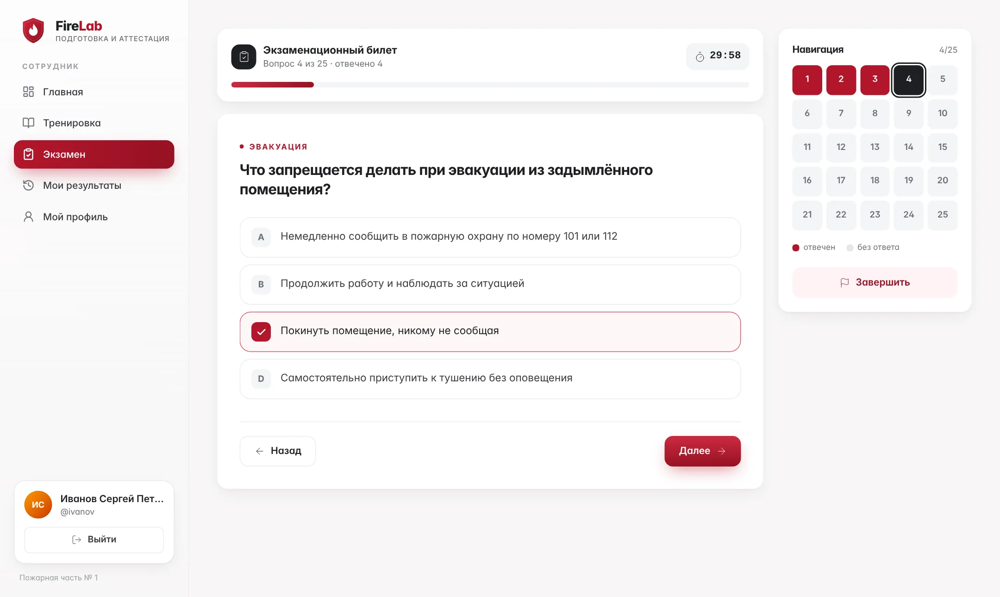
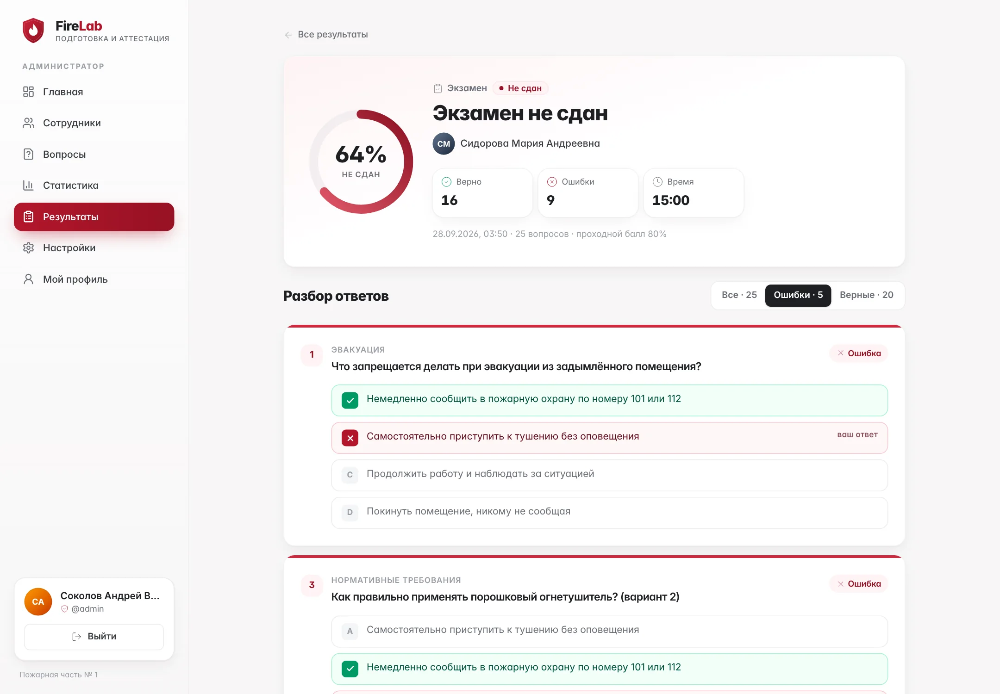
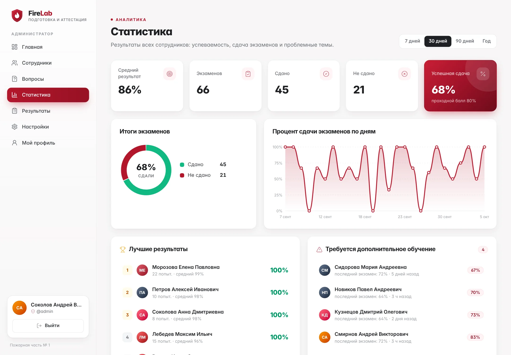
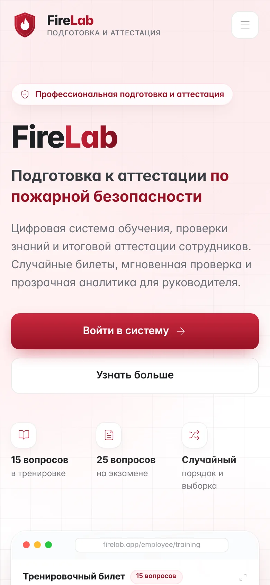
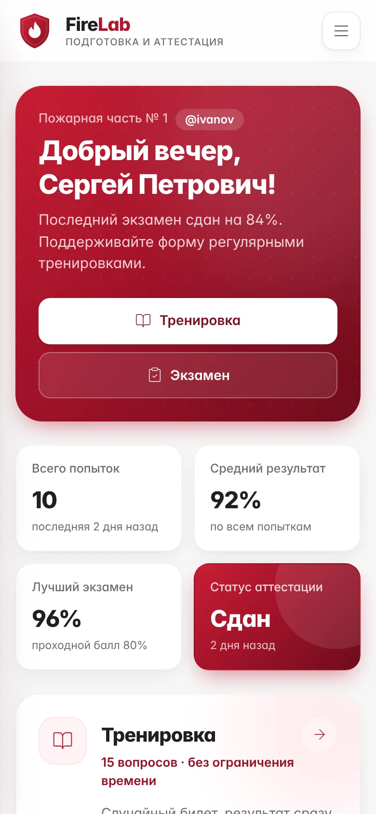

<div align="center">


# FireLab

**Тестирование и аттестация сотрудников по пожарной безопасности**

Случайные билеты · мгновенная проверка · разбор ошибок · аналитика для руководителя

<br />


<br />



</div>

<br />

## О проекте

FireLab — веб-приложение для подготовки и аттестации сотрудников по пожарной безопасности и охране труда. Сотрудник тренируется на случайных билетах и сдаёт экзамен, а руководитель видит результаты всей команды, слабые темы и тех, кому нужна дополнительная подготовка.

Вся инфраструктура укладывается в **бесплатные тарифы**: фронтенд на Vercel или Cloudflare Pages, база, авторизация и серверная логика — в Supabase. Отдельный сервер не нужен.

<br />

## Возможности

<table>
<tr>
<td width="50%" valign="top">

### Для сотрудника
- **Тренировка** — 15 случайных вопросов, новый билет при каждом запуске
- **Экзамен** — 25 вопросов, таймер на сервере, проходной балл
- Перемешивание вопросов **и** вариантов ответа
- Навигация по билету, управление с клавиатуры
- Мгновенный результат и **разбор ошибок с пояснениями**
- История попыток и личный прогресс по темам
- Личный профиль: ФИО и смена пароля

</td>
<td width="50%" valign="top">

### Для руководителя
- **Дашборд**: сотрудники, прохождения, средний балл, % сдачи
- **Сотрудники**: добавление, редактирование, блокировка, профиль
- **Банк вопросов**: категории, варианты, правильный ответ, пояснение
- **Статистика**: графики по дням, лучшие результаты, сложные вопросы
- Список сотрудников, которым **нужна подготовка**
- Журнал всех попыток с фильтрами
- **Настройки**: проходной %, число вопросов, время экзамена

</td>
</tr>
</table>

<br />

## Скриншоты

<table>
<tr>
<td width="50%"><p align="center"><sub>Дашборд руководителя</sub></p></td>
<td width="50%"><p align="center"><sub>Экзамен: таймер и навигация по билету</sub></p></td>
</tr>
<tr>
<td width="50%"><p align="center"><sub>Разбор ошибок с пояснениями</sub></p></td>
<td width="50%"><p align="center"><sub>Статистика и сложные вопросы</sub></p></td>
</tr>
</table>

<div align="center">

&nbsp;&nbsp;&nbsp;

<p><sub>Адаптивная вёрстка: телефон, планшет, ноутбук</sub></p>
</div>

<sub>На скриншотах — демонстрационные данные.</sub>

<br />

## Стек

| Слой | Технологии |
|---|---|
| Интерфейс | React 18, TypeScript, Vite, React Router, Tailwind CSS, Lucide Icons |
| Данные и доступ | Supabase: PostgreSQL, Auth, Row Level Security |
| Серверная логика | PL/pgSQL-функции (выдача и проверка билетов, статистика), Edge Function `admin-users` |
| Хостинг | Vercel или Cloudflare Pages (бесплатно) |

<br />

## Быстрый старт

```bash
git clone https://github.com/<user>/<repo>.git
cd <repo>
npm install
cp .env.example .env.local      # Windows: Copy-Item .env.example .env.local
```

1. Создайте бесплатный проект в [Supabase](https://supabase.com/dashboard) и впишите в `.env.local` URL и ключи.
2. В **SQL Editor** выполните по порядку файлы `supabase/migrations/001…005`.
3. Разверните функцию: `npx supabase functions deploy admin-users --no-verify-jwt`.
4. Создайте администратора: `npm run seed`.
5. Запустите: `npm run dev` → http://localhost:5173

Подробная пошаговая инструкция (Supabase, деплой на Vercel, частые ошибки) — в **[docs/SETUP.md](docs/SETUP.md)**.

<br />

## Команды

| Команда | Что делает |
|---|---|
| `npm run dev` | Локальный сервер разработки |
| `npm run build` | Production-сборка в `dist/` |
| `npm run preview` | Просмотр production-сборки |
| `npm run typecheck` | Проверка TypeScript |
| `npm run check` | Typecheck + build |
| `npm run seed` | Создание или восстановление администратора |

<br />

## Безопасность

- **Row Level Security на всех таблицах.** Сотрудник видит только свои данные и не может прочитать банк вопросов или правильные ответы.
- **Проверка ответов на сервере.** Билет выдаёт и проверяет PostgreSQL, процент нельзя подделать из браузера. Таймер экзамена тоже серверный.
- **Неизменяемая история.** Каждая попытка хранит снимок вопросов, поэтому правка банка не меняет старые результаты.
- **Секреты не в коде.** Пароли хранятся только в Supabase Auth в виде хэша. Ключ `service_role` используется только в Edge Function и в локальном seed-скрипте, во фронтенд он не попадает.
- **Нет внешних трекеров и CDN.** Шрифты подключаются локально, данные посетителей не уходят третьим лицам.

> [!IMPORTANT]
> Никогда не коммитьте `.env.local` (он уже в `.gitignore`). В Vercel добавляйте только `VITE_SUPABASE_URL` и `VITE_SUPABASE_ANON_KEY`.

<br />

## Структура

```
src/
├── components/   UI-кит, графики, иллюстрации лендинга
├── hooks/        useAsync, useSettings, useReveal, useTitle
├── layouts/      AppShell — сайдбар и мобильное меню
├── lib/          клиент Supabase, авторизация, защищённые маршруты
├── pages/        landing · login · admin/* · employee/* · shared/*
├── routes/       маршрутизация (кабинеты загружаются лениво)
├── services/     запросы к Supabase
└── types/ utils/ styles/
supabase/
├── migrations/   схема, RLS, RPC-функции, банк вопросов
└── functions/    Edge Function admin-users
scripts/          seed-admin.mjs
docs/             SETUP.md, скриншоты
```

<br />

<div align="center">
<sub>FireLab · сделано для подготовки и аттестации сотрудников по пожарной безопасности</sub>
</div>
